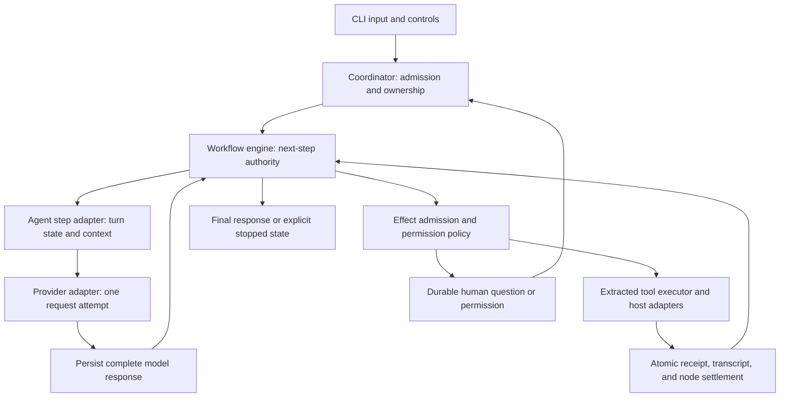

# zfacade — Revised extraction and execution plan

**Date:** 2026-10-24  
**Status:** proposed implementation plan; documentation only. No implementation or acceptance pass is claimed.  
**Original:** [PLAN.md](./PLAN.md), preserved unchanged.  
**Objective:** extract a standalone CLI coding agent from ZCode whose workflow compiler and engine own the coding loop, retaining real model I/O, tools, permissions, compaction, project memory, and recoverable local sessions.

This document incorporates the review feedback posted in chat before its creation. It replaces the original plan's implementation sequence and fills in its ownership, recovery, and security contracts. The choices below are proposed defaults, not claims that the user previously selected an execution design.

**Planning correction — deferred local serving (2026-10-24):** I omitted the explicit serving component needed to run the project's eventual fine-tuned model locally. The inspected ZCode provider path supplies an `openai-compatible` HTTP client adapter, not a model-loading inference server. Reuse that adapter and add a local serving component after the training project produces an exportable artifact. Per the user's priority, do not select/install a serving backend or make local model loading a prerequisite for starting training. Tinker supplies sampling and optimization during training; local serving remains a separate post-training deployment deliverable. No serving backend is selected by this correction.

## 1. Review findings and decisions

| Priority | Finding in the original plan | Decision in this revision |
| --- | --- | --- |
| P0 | Workflow ownership is postponed until Phase 3; Phase 2 builds another autonomous turn loop. | Prove engine-owned model and tool steps in the first integrated slice. Do not ship a temporary independent scheduler. |
| P0 | Journal replay is treated as sufficient for safe effect recovery. Upstream retries a `running` world operation, including `world.run`. | Add effect receipts, atomic local settlement, and reconciliation holds for unknown outcomes before advertising crash-safe resume. |
| P0 | A VM child is called a sandbox while stronger isolation is deferred. The current harness inherits the parent's environment. | Use a trusted built-in skeleton first; minimize the child environment. Gate automatic execution of model-authored scripts on a separate isolation acceptance test. |
| P1 | Session history, command admission, workflow journal, and process lifetime lack a unified ownership contract. | One coordinator and fenced writer per workspace; one transaction authority for local state; explicit process supervision and cancellation settlement. |
| P1 | Actor `ask`, human clarification, and permission requests are conflated. | Separate typed contracts with durable identities and distinct settlement rules. |
| P1 | A whole coding turn inside an actor can hide many model/tool iterations from the engine. | Adapt the turn machine into bounded steps. Every model request and tool invocation has an engine-visible identity and receipt. |
| P1 | Memory extraction is moved to phases without specifying compaction ordering, persistence, or concurrent writers. | Use committed transcript boundaries, durable cursors, and a single writer per memory root; preserve no-op/skip semantics. |
| P1 | “No remote” conflicts with model APIs, fetch tools, and arbitrary local commands. | Define local ownership separately from network capability; do not claim offline enforcement without OS-level egress controls. |
| P1 | “Re-pin to HEAD” and optional checkout parity are not reproducible. | Freeze immutable revisions, record original and adapted hashes, and ship offline test evidence/fixtures. |
| P2 | Scope and package lists omit transitive imports, generated compiler assets, repository instructions, and distribution details. | Inventory the dependency closure; define package directions, configuration trust, runtime versions, packaging, and release gates. |

P0 blocks the first architectural acceptance claim. P1 must be resolved before its associated feature is declared complete. Deferred features must be absent from the advertised tool catalog, not represented by success-shaped stubs.

## 2. Evidence and baseline

The review read all of the original plan and checked selected upstream implementation paths. It did not run agent sessions, crash tests, or the upstream unit suites.

| Input | Observed baseline |
| --- | --- |
| Original plan | SHA-256 `29b2469a5ab37d2402d7da1210b2ce925a350097bdbfd995183436a3695daa0b` |
| ZCode | `/Users/mac/ZCode`, HEAD `042d4f6a36ceb9c96f30f4d955d23b8fe75e3b11`; clean at inspection |
| Prior extraction host | `/Users/mac/interactive-task-engine`, HEAD `87b16e73c6c2ee0ddcc23b8b85b1255bbd1c2603`; dirty at inspection |
| ITE provenance | Records ZCode `29628c9acdb81b703bbd4080c207a0e7ce5e276e` and extraction revision `a3d4e2813c583e5a7382f3a61ffb615948060079`; records 13 workflow modifications |
| Upstream toolchain | `mise.toml` pins Node `24.14.0`, pnpm `10.33.2` |
| zfacade | Initially contains `README.md` and `PLAN.md`; no implementation workspace |

ITE's dirty paths included `docs/UNIFIED-SKILL-ENGINE-ARCHITECTURE.md`, `src/skills.rs`, and untracked `experimental/`, `four-systems.md`, and workflow experimental files. Treat that checkout as read-only research input. Do not silently import its uncommitted work.

The reviewed ZCode revision is the proposed extraction baseline. If implementation selects another revision, rerun the inventory and record why. Do not resolve “current HEAD” dynamically during a build or parity test.

Source anchors supporting the changes:

- [Workflow driver contracts](../ZCode/apps/zcode-cli/packages/dynamic-workflow/src/engine/types.ts): `startAsk` dispatches to an actor session; existing node kinds do not expose a complete model/tool-step lifecycle.
- [World-operation replay](../ZCode/apps/zcode-cli/packages/dynamic-workflow/src/engine/engine-world.ts): a recorded `running` operation falls through to live execution; the same path includes `world-run`.
- [Runtime harness](../ZCode/apps/zcode-cli/packages/dynamic-workflow-runtime/src/harness.ts): child spawn spreads `process.env`; source/lowered-code consistency belongs to the caller.
- [SQLite journal adapter](../ZCode/apps/zcode-cli/packages/adapters/src/storage/session-store/repositories/dwf-journal.ts): cross-session transaction composition belongs to the driver, not `JournalStorePort` alone.
- [Current turn loop](../ZCode/apps/zcode-cli/packages/core/src/runtime/methods/turn-loop.ts): owns repeated model/tool work and checks compaction within that loop; this ownership must be adapted.
- [Memory scheduling integration](../ZCode/apps/zcode-cli/packages/core/src/runtime/helpers/project-memory-extraction.ts), [gate/scheduler](../ZCode/apps/zcode-cli/packages/core/src/memory/extraction.ts), and [path helper](../ZCode/apps/zcode-cli/packages/core/src/memory/memory-file-path.ts): snapshot boundaries, disabled extraction, cursor decisions, and lexical path checks need surrounding persistence and filesystem enforcement.
- [ITE durable execution design](../interactive-task-engine/docs/DURABLE-EXECUTION.md): explicitly distinguishes stable operation receipts and reconciliation from exactly-once external effects. Its historical validation statements are not current zfacade test results.
- [Node VM documentation](https://nodejs.org/api/vm.html): VM contexts are not a security mechanism for untrusted code.

## 3. Product boundary

### 3.1 Required product

1. CLI REPL and headless prompt execution using real streaming model I/O.
2. Engine-owned coding steps using extracted Read, Write, Edit, ApplyPatch, Bash, Grep, Glob, and associated contracts/policies. Preserve useful task tracking and tool-result display behavior where required by the prompt/tool contract.
3. Local session history, workflow journal, command receipts, permissions, questions, tool receipts, and artifacts with explicit restart behavior.
4. Compaction and project memory integrated with the same scheduling and effect authority.
5. Text/JSON inspection of run state, graph analysis, pending questions, permissions, recovery holds, and artifacts.
6. No dependency on an external coding-agent CLI to implement the actor. Deterministic provider doubles are allowed in tests; release evidence also requires a real provider.

### 3.2 Local ownership and network policy

“Local-only” means the coordinator, workspace, state, tools, and session ownership run locally. It excludes remote workspace hosts, relay/pairing, cloud session sync, remote control planes, source-server, and telemetry export.

Network access is an explicit capability:

| Capability | Initial policy |
| --- | --- |
| Model endpoint | User-configured local or hosted endpoint; authenticated through the provider adapter |
| Model catalog/config | Local files; no implicit cloud configuration fetch |
| WebFetch/WebSearch | Deferred; later explicit capabilities with their own policies |
| Local Bash | May invoke network-capable programs when authorized; being a local process does not make it offline |
| Local stdio MCP / hooks | Deferred; process launch and inherited credentials require explicit trust when added |
| Telemetry/update/marketplace sync | No automatic remote calls |

An offline profile requires a local provider plus enforced egress restrictions for relevant processes. Do not market the baseline permission classifier as a network firewall or OS sandbox.

### 3.3 Platform and process scope

Use TypeScript/Node for the initial host and the reviewed upstream Node/pnpm versions. Validate macOS and Linux for the first release. Keep portable path/process interfaces, but mark Windows unsupported until its own process-tree, path, terminal, and packaging gates pass.

The foreground CLI owns execution. Closing or killing it is not a promise of continued background progress. Restart recovers durable state and reconciles unfinished work. A daemon, service manager, distributed scheduler, or Rust host is a separate future scope.

## 4. Execution architecture: engine ownership from the first slice

### 4.1 Chosen initial shape

Start with a host-authored, versioned workflow skeleton compiled and analyzed by the extracted compiler. Model output is data: text, structured tool calls, and explicit completion/control outcomes. The model does not generate the executable main-loop JavaScript in the first release slice.

The skeleton repeats bounded coding steps. Each provider request and each tool invocation becomes a separately identifiable workflow operation. A complete assistant turn is a grouping of those steps, not a hidden loop running inside one opaque actor request.

This is a deliberate adaptation, not an assertion that `WorkflowEngine` already supplies model-step and human-question nodes. The first implementation milestone must choose and test the minimal engine/facade extension, including compiler/lowering, runtime protocol, driver, journal schema, and projections. No unjournaled helper may execute the actual step while a nominal workflow node merely watches it.

### 4.2 Bounded agent contract

Adapt ZCode's turn machine and model/tool settlement functions behind a `step` contract. These names describe proposed interfaces, not existing exports:

- `prepareStep`: consume a committed transcript/context revision; return a model request or an explicit compact/wait/finish requirement.
- `requestModel`: execute one provider attempt with cancellation and streaming display. Assemble and validate the complete response before making its tool calls runnable.
- `acceptModelResponse`: persist assistant content and the ordered, validated tool-call batch; assign stable operation IDs.
- `executeTool`: run one admitted invocation through the extracted executor; persist structured results and full-output artifact references.
- `settleStep`: advance the turn machine after the required results are committed; yield control to the engine.

Keep upstream algorithms where their behavior is correct. Extract one iteration from `runRegularTurnLoop` rather than retaining its independent `while` loop. Provider transport retries may remain bounded inside an operation, with recorded attempts; they must not dispatch tools or silently begin a subsequent model step.

At first, tool calls execute serially in provider order. Later concurrency requires declared read/write conflicts, preserved result ordering, and per-workspace mutation serialization. A read-looking Bash command is not automatically safe to parallelize.

### 4.3 Distinct questions and controls

| Operation | Owner and behavior |
| --- | --- |
| Actor `ask` | Workflow engine dispatches an instruction/schema to a coding actor. Preserve upstream typed submission validation/repair semantics. It is not a human prompt. |
| Human clarification | Persist a question ID, owning run/revision/step, schema/options, and pending state. A correlated answer makes that step eligible to resume. |
| Permission request | Persist exact canonical operation, targets, cwd, policy digest, and scope. Approval is bound to that operation, not merely an affirmative string. |
| Status | Read-only projection; never enters the model input queue and never cancels or steals execution ownership. |
| New task input | Durable command ID and FIFO admission; accepted input is not lost on restart. |
| Steering | Durable command delivered at the next safe model-step boundary; already admitted effects retain their identities and outcomes. |
| Cancel | Persist cancellation fence, reject new effects, abort provider/tool/process work, then settle after cleanup or report an explicit unresolved cleanup state. |

Human waits release model concurrency capacity and block only the affected lane. Duplicate answers are idempotent; wrong-run, stale-revision, and already-closed answers are rejected. Headless execution must not hang waiting on a nonexistent TTY: denied permission or required clarification produces a structured resumable outcome and documented exit status.

### 4.4 Ownership rules

- Coordinator owns command admission, writer lock, recovery orchestration, and process supervision.
- Workflow engine owns which coding operation may run next and dependency/actor ordering.
- Agent state machine owns conversation semantics and valid transitions, but cannot schedule independent provider/tool work.
- Effect service owns authorization, invocation receipts, cancellation, and external-operation reconciliation.
- Store adapter owns database transactions and migrations. Terminal output is a projection of committed state plus explicitly transient stream deltas.

Any background memory work, actor, hook, or MCP invocation must use this authority. “Internal” is not an authorization bypass. Actor support is a core driver requirement; the user-facing general subagent tool can be deferred.

## 5. Persistence and recovery contract

### 5.1 Storage and identity

Use a user storage directory with one workspace-scoped SQLite database and separate artifact bytes. Keep the database outside the editable repository. Derive the workspace key from a persisted canonical local identity; keep actual cwd distinct. Different worktrees are separate workspaces by default; memory sharing across them is explicit.

Use one shared transaction service for session and workflow repositories. Run the upstream `JournalStorePort` contract, then add cross-repository contract tests: interface compliance alone does not prove crash consistency.

Record at least:

- Workspace/session/run IDs, immutable run revision, command ID, actor ID, model-step ID, provider attempt ID, tool-call/operation ID, and owner generation.
- Source, compiled/lowered output, facade/compiler/runtime versions, input hashes, tool catalog/schema version, and configuration/policy digests.
- Model request identity, complete accepted responses, ordered tool calls/results, context revision, token usage when supplied, and partial-stream interruption markers.
- Human questions, permission grants/denials, effect intent/start/result receipts, cancellation fences, and reconciliation decisions.
- Memory extraction boundaries/cursors and compaction checkpoints.

Never store provider secrets in manifests, journals, environment snapshots, or logs. Store credential references and redacted configuration instead. Transcript and artifact retention is configurable because local persistence can still contain sensitive user material.

### 5.2 Transaction boundaries

1. **Admission:** commit command receipt and initial run/step intent before acknowledging accepted input.
2. **Model response:** commit the complete response, ordered tool intents, and corresponding model-step settlement together before any tool runs.
3. **Tool dispatch:** commit the validated intent and applicable authorization before execution; record dispatch/start state. A crash between dispatch and confirmed start is potentially ambiguous.
4. **Tool settlement:** commit immutable result receipt, transcript result reference, node state, and settlement event together. The first accepted receipt wins; conflicting duplicates are errors.
5. **Question answer:** validate and commit the answer/permission decision and its consumption state before resuming dependent work.
6. **Compaction:** atomically install the new context revision/checkpoint while retaining the original durable evidence and unresolved operation references.

Filesystem and shell effects cannot share an atomic transaction with SQLite. The following recovery rules address that gap; no exactly-once claim is made for arbitrary external effects.

### 5.3 Effect recovery rules

| Persisted situation | Recovery behavior |
| --- | --- |
| Intent definitely not dispatched | Reevaluate current authorization and dispatch the same operation identity when eligible |
| Committed completed receipt | Replay recorded result; do not invoke the effect again |
| Pure computation or unfinished read | Retry only under a declared policy; record a new attempt; completed reads retain their recorded results |
| File mutation with verifiable pre/post state | Inspect content hashes and operation receipt; recover success only when evidence establishes it, otherwise hold |
| Shell/git/MCP/hook dispatched or started without a trustworthy terminal receipt | Mark `outcome_unknown`; block dependent effects until explicit reconciliation/retry decision |
| Interrupted model stream | Preserve interruption; do not execute partially assembled tool calls; a new provider request is a new attempt and may incur another charge |
| Old owner/revision completion | Reject as a state mutation; retain diagnostic receipt without reviving cancelled/superseded work |

An operation key should include run revision, site/step ordinal, tool-call ordinal, and canonical input digest. Passing a key to a shell command does not make the command idempotent. A missing PID or a changed file is not by itself proof of successful completion.

Patch or wrap upstream replay so an in-flight `world.run` cannot bypass these rules. Both workflow world operations and actor tool invocations must use the same effect service.

### 5.4 Writer and process ownership

Acquire a local OS-backed exclusive coordinator lock for the workspace and maintain a monotonically fenced owner generation in the database. A second CLI may inspect committed state but cannot resume the same workspace concurrently. Stale-lock recovery must prove the prior local owner has exited; heartbeat expiry alone is insufficient. Do not support state storage on network filesystems initially.

Supervise subprocess trees, including shell descendants. Persist operation identity, launch metadata, output locations, and observed exit information. Use PID plus start identity where available; never kill a process based solely on a reused PID. On host loss, unfinished external work is reconciled before retry, even if no process remains alive.

Use verified SQLite durability settings, bounded busy handling, versioned migrations, and tested backup/restore. Back up via a consistent database snapshot plus referenced artifacts; copying an active main database file alone is not the backup contract. Resume rejects incompatible runtime/compiler/schema identities unless an explicit migration succeeds.

## 6. Security, permissions, and executable code

### 6.1 Every effect uses the same admission path

Extract the permission mode ladder, broker, rule matching, Bash analysis/readonly family, path policy, input rechecks, and structured prompt facts together. Validate schemas before authorization and revalidate the final execution input after any permitted transformation.

- Permission grants bind exact arguments, cwd, workspace, relevant targets, revision, and policy identity. A changed command/path needs a fresh decision.
- Headless operation denies an effect when no explicit applicable policy grants it; read/inspection defaults must also be defined rather than assumed.
- Interactive operation uses precise prompts. Do not introduce a generic `--yes` that silently means bypass all permissions. Any dangerous bypass mode must be separately named, opt-in, and visible in receipts.
- Tool catalog, executor, workflow world operations, memory writes, and future subagents/MCP/hooks cannot take different authorization shortcuts.
- Cap tool output and execution duration, retain truncation metadata and artifact references, and distinguish nonzero exit, timeout, cancellation, denial, and infrastructure failure.
- Render untrusted terminal text safely: control sequences and artifact paths must not become executable terminal instructions.

### 6.2 Trusted skeleton versus generated workflows

The initial compiled skeleton is bundled and hash-pinned; prompts and tool arguments enter it only as validated data. Do not interpolate model text into executable JavaScript or accept arbitrary lowered code from a CLI request.

The runtime child receives an explicit minimal environment, controlled cwd, bounded memory, CPU/execution time, message sizes, and stdout/stderr volume. Strip credentials and injection-sensitive environment such as inherited Node preload options. Those measures reduce exposure but do not turn `node:vm` into a security boundary.

Static analysis/type checking does not prove arbitrary generated code safe. Until tested OS/container isolation prevents unauthorized filesystem/network/process access, model-authored workflows may be analyzed and displayed but are not automatically executed. Define and validate the isolation backend per supported platform. Linux Bubblewrap is a candidate, not a cross-platform answer. User review is not a substitute for an enforced capability boundary.

Model-authored execution is a later feature with its own release gate, not a prerequisite for the trusted skeleton to own coding work.

## 7. Memory, context, and compaction

### 7.1 Memory extraction scope

Retain the source-derived extraction gate, path fence, project-root derivation, manifest scan, index truncation, and nested memory-agent tool policy. Include the actual integration helpers and their tests, not only the exported pure package.

Memory-agent mutation is limited to Markdown files in its configured root and narrowly parsed, fenced removal. Read scope is separately defined by the session policy; a write fence does not imply read confinement. No general Agent, workflow launch, MCP, or hook capability is exposed to this maintenance actor.

The nested model/tool loop must be adapted to the same step/effect authority as the main actor. Preserve its behavior through parity tests; do not keep a second free-running background mutation loop merely because it is called memory maintenance.

### 7.2 Filesystem enforcement

Retain lexical traversal and sensitive-segment checks, then enforce actual filesystem targets in the adapter: canonical root, symlinked ancestors/targets, nonexistent write targets, hard-link risks, and platform-specific path behavior. Use atomic replacement for writes and safe descriptor-relative/no-follow operations where supported. Rechecking `realpath` followed by an ordinary path write is not by itself a race-free guarantee.

Reject operations whose target containment cannot be established. Test link swaps and deletion separately; if a platform cannot enforce the claimed boundary, disable that mutation path or narrow the documented guarantee rather than silently treating lexical checks as sufficient.

The `memory.file.markdown` permission exception applies only to the intended memory operation after all target checks. It never bypasses general workspace isolation or allows arbitrary writes by a different actor.

### 7.3 Scheduling and cursor semantics

1. Capture an immutable active-branch transcript boundary after committed work, before the relevant history is compacted out of the model context.
2. Schedule extraction only when enabled. Default automatic extraction off for headless execution unless explicitly enabled; expose the setting in CLI/config.
3. Serialize extraction per memory root, including across sessions; coalesce pending snapshots without losing their committed boundary identities.
4. Persist the cursor keyed by session/branch and memory root. Preserve upstream successful/no-op advancement and policy-approved skip advancement; failure/abort does not advance it.
5. Journal memory file mutations individually. A crash after a write but before cursor settlement must reconcile that write before rerunning the extraction. Files and SQLite are not one atomic transaction.
6. Freeze a memory/index revision per model request. Refresh on a committed memory update at a safe step boundary; restart loads the current index. Do not retain a stale index for an entire long session by accident.

A fact file is not required for every user message. Extraction may correctly skip, merge, or make no change. Acceptance uses a controlled durable-preference fixture and separately tests skip/no-op cases. Memory content is evidence/context, not higher-priority instructions or executable configuration.

### 7.4 Compaction placement

Check context budget before every model request, including requests within one long user turn. `phase` labels are useful progress metadata, not the only points where compaction can run.

Preserve tool-call/result pairing, pending questions, admitted effects, actor state, and final-result contracts. Microcompaction changes model-visible context, not the immutable operation receipts needed for recovery. Model-backed summarization is itself an observable scheduled request; failed compaction must not erase history or manufacture a successful checkpoint.

Defer dream/consolidation, semantic selection, and custom-agent persistent roots. Do not import their scheduling dependencies merely because the current turn loop references them.

## 8. Extraction and package boundaries

### 8.1 Baseline strategy

Use the prior extraction to identify seams, retained tests, and known defects. Do not blindly upgrade its workflow package while retaining old compact/memory/permission contracts.

For each selected subsystem, compare the pinned ITE extraction with the pinned ZCode revision and decide: copy unchanged, adapt, replace with current upstream, or exclude. Record local ITE improvements separately from ZCode source. In particular, ITE's production Duroxide integration is not contained in the old `WorkflowBox` wrapper and is not acquired by vendoring that wrapper.

Choose one canonical source tree for extracted code: `vendor/zcode-core/` with package exports consumed by facade packages. Do not keep independent editable copies of the same algorithms in both `vendor/open-agent-core` and `facade-core`. The facade layer contains zfacade contracts, composition, and documented adaptations. Keep policy/algebra separate from Node adapters even when upstream package names obscure the distinction.

Each provenance entry records origin repository/revision/path, original bytes hash, destination path/hash, copy or adaptation classification, patch/reason, applicable test IDs, and license/notice source. Hashes establish provenance, not behavioral equivalence. Preserve license and attribution files from each included source; inventory dependency notices before distribution rather than assuming one root notice covers all transitive packages.

### 8.2 Package graph

| Package | Owns | Allowed internal dependencies |
| --- | --- | --- |
| `facade-contracts` | Runtime-validated command, step, effect, question, storage, provider, and presentation contracts | No runtime package |
| `facade-core` | Extracted compiler/analyzer/engine plus compact, memory, permission decision functions | Contracts and explicitly selected vendored algorithms |
| `facade-agent` | Bounded turn adaptation, context assembly, tool handlers, memory actor behavior | Contracts, core; ports for all external I/O |
| `facade-runtime` | Workflow child harness and protocol; lifecycle adapter | Contracts, core; no concrete agent/model implementation |
| `facade-adapters` | Filesystem, process, SQLite, model transport, local config and artifact implementations | Contracts; narrow source-derived types where needed, no dependency on CLI |
| `facade-cli` | Composition root, coordinator startup, commands, REPL, terminal/JSON rendering | Public exports of the above packages |

Run import/dependency checks from the first build. Reject cycles, deep cross-package implementation imports, UI dependencies, and unresolved monorepo aliases. Scan dynamic imports and bundled output as well as static imports. Do not copy a broad upstream `deps.ts` barrel that reintroduces discarded services.

### 8.3 Required extraction inventory

Paths below are relative to `ZCode/apps/zcode-cli/packages/` unless otherwise stated. This is a subsystem inventory; Phase 0 expands it into file-level dependency closure before implementation claims completeness.

| Area | Source / required surrounding behavior | Treatment |
| --- | --- | --- |
| Compiler/analyzer/lowering | `dynamic-workflow/`: schemas, facade, graphs, taint/causality, diagnostics, tests, generated TypeScript library assets and generation scripts | Extract core surface; generated outputs must build without the source monorepo |
| Engine/replay | `dynamic-workflow/src/engine/`: scheduler, ordering, hashing, actor state, journal contract, settlement, cancellation, artifacts | Preserve algorithms; explicitly adapt bounded coding steps and effect recovery |
| Runtime | `dynamic-workflow-runtime/`: child entry, protocol, harness, stream bounds | Extract with environment and lifecycle changes; drop Electron/SEA branches |
| Driver | `bootstrap/src/app/workflow-driver*.ts` and related world/artifact/concurrency helpers | Port reusable policies; build local driver against the bounded agent contract; retain validation and cancellation behavior |
| Turn state | `core/src/agent/` and `core/src/runtime/methods/{turn-loop,turn-model-step,turn-tools}*`, settlement helpers | Extract behavioral core; remove independent scheduling ownership |
| Model transport | `adapters/src/model/` and provider/config support | One explicitly selected provider protocol first; preserve stream assembler, error, cancellation, usage, and retry semantics |
| Tools | `contracts/src/tools/`, `core/src/tool/` handlers, registry, executor, scheduler, serializers, artifact and read-state support | Extract required coding subset plus whole policy dependency families |
| Permissions | `core/src/permission/`, Bash policies, executor approval and input-recheck helpers | Required; no alternate workflow bypass |
| Session/journal storage | `adapters/src/storage/session-store/`, repositories and relevant migrations | Preserve schema semantics; use an audited fresh zfacade schema and explicit migrations, never open upstream user DBs in place |
| Command admission | `bootstrap/src/zcode-protocol-v4/command-inbox.ts`, runtime command helpers | Preserve FIFO/correlation/receipts and local snapshots; remove remote routing while retaining local owner fencing |
| Context/instructions | `core/src/context/`, section builders, system reminders, local instruction/config adapters | Include AGENTS.md/project instruction discovery, precedence, cwd/workspace identity, context budgeting, and provenance |
| Memory | `core/src/memory/` plus project-memory runtime helpers | Gate/fence/manifest/index/root and real nested actor integration; add durable scheduling and filesystem enforcement |
| Compaction | `core/src/compact/` plus model/context and persistence integration | Preserve decisions and pairing guarantees; wire before each model request |
| Presentation | `core/src/tool/handlers/workflow-analysis-display.ts`, tool-result display, graph serialization, permission facts | Keep bounding/truncation semantics; text/JSON renderers; original output bytes remain separately available |
| Search and artifacts | Native-search integration, artifact persistence and safe resolution | Pin/require supported `rg`; test missing dependency; durable bounded output storage |

Repository instructions are prompt context, not authority to change host permission policy. Workspace configuration cannot silently start hooks/MCP, change credential sources, or grant a dangerous permission mode. Define precedence and trust separately: installation defaults, user policy/config, trusted workspace settings, session choices, explicit CLI options. Secrets remain in environment or user credential storage, not tracked workspace files.

The first provider choice is an implementation-time configuration decision based on available credentials, not a reason to invent a fake backend. Additional provider support needs its own real streaming/tool-call acceptance. Do not copy the entire catalog/auth product just to support one endpoint.

### 8.4 Cut and defer register

| Surface | Status and consequence |
| --- | --- |
| Electron, desktop/web/mobile renderers, DOM components, animation | Cut; no imports or runtime requirement |
| Remote hosts, relay, pairing, source-server, cloud session sync, share/control APIs | Cut; local CLI recovery replaces only the needed local behavior |
| Marketplace, UI plugins, onboarding, billing/coding plans, automation/cron product | Cut; no nominal tool entries |
| Office/PDF/browser/CUA runtimes, Node REPL/browser host | Deferred unless a demonstrated core dependency requires a narrowly documented seam; no execution in initial catalog |
| Telemetry exporters | Cut; local redacted diagnostics retained |
| Full protocol v4 remote stream/snapshot machinery | Cut; keep local command/result schemas, event sequence/correlation, and inspection projections |
| Hooks, local stdio MCP, local executable skills, general Agent tool | Deferred until explicit trust, lifecycle, and effect gates pass |
| Basic AGENTS.md/context loading | Required early; it is not the deferred skills marketplace |
| Model-authored create/eval/fill-hole workflows | Deferred execution pending isolation; preserve compiler analysis and graph capability |
| Memory dream, semantic selector, per-custom-agent roots | Deferred; remove incidental runtime dependencies |
| Rust host / Duroxide | Research input only for initial implementation; reconsider only if measured requirements exceed the bounded local design |

Unsupported capabilities return explicit unavailable errors if a stored session references them. They must never produce substitute tool results or simulated success.

## 9. Delivery sequence and stop conditions

Each phase ends with runnable evidence. A failed gate is unresolved work, not permission to label the phase complete. Documentation stays proportional to the implementation: one file inventory, one decision log, and reproducible acceptance receipts are sufficient.

### Phase 0 — Freeze and specify

1. Record immutable upstream/extraction baselines, hashes, existing local deltas, and required notices.
2. Expand the inventory to actual import closure and tests for the first slice; include generated compiler assets and build scripts.
3. Specify the minimal coding-step engine extension and transaction schema from sections 4–5. Resolve any upstream incompatibility here, not after extracting the whole agent.
4. Create boundary fixtures for commands, model responses, tool results, human questions, and effect recovery; explicitly define supported platforms and network behavior.

**Exit:** reviewed source map plus executable-contract design. Scaffolding may start, but no coding-agent or durability claim yet.

### Phase 1 — Engine-owned vertical slice

1. Create the package workspace and locked toolchain; vendor the smallest complete compiler/engine/contract slice.
2. Compile a trusted coding skeleton with graph output; add the bounded agent-step/driver integration.
3. Wire one real model provider, Read/Edit/Bash sufficient for a small fixture task, the full relevant permission/path policies, and SQLite session/journal/effect receipts.
4. Implement a minimal headless CLI and human permission/clarification outcomes. Keep trusted built-in execution only.
5. Prove model → tool → model → final through the engine, and inject a crash after an effect but before recorded success.

**Exit:** a fixture test is repaired using real tools and a real model; traces prove each model/tool operation is engine-owned. Ambiguous mutation recovery holds instead of rerunning. If the turn-machine seam cannot support this, revise the architecture before broad extraction.

### Phase 2 — Complete the core CLI

1. Finish Read/Write/Edit/ApplyPatch/Grep/Glob/Bash, output artifacts, instruction loading, and explicit tool catalog behavior.
2. Add REPL, durable input FIFO, status/inspect, sessions list/resume, clarification/permission answering, and cancellation.
3. Add pre-request compaction and the real memory actor with persisted cursor and target enforcement.
4. Finish single-writer fencing, atomic settlements, migrations, recovery commands, backup/restore, and process-tree lifecycle tests.

**Exit:** core acceptance A1–A13 below passes. This is the first complete core CLI milestone; there is no later architectural inversion left to perform.

### Phase 3 — Controlled workflow expansion

1. Expose analysis/graph commands and model authoring diagnostics; execute generated scripts only after isolation gate A14 passes on that platform.
2. Add multi-actor execution under the same effect authority. Serialize overlapping mutations or isolate explicitly assigned worktrees; no automatic merging over user changes.
3. Add local MCP/hooks/skills individually with trust, environment, cancellation, and recovery tests. Keep unavailable surfaces absent.
4. Support revised workflows as immutable successor revisions with explicit input/cache compatibility. Never silently transplant completed effects into changed scripts.

**Exit:** A14–A16 pass for enabled features, including sibling progress during a human wait and stale-revision rejection. Deferred features remain explicitly deferred.

### Phase 4 — Release hardening

1. Audit provenance and every intentional behavioral deviation; run pinned offline parity and integration suites.
2. Test install/build/run in a clean directory with neither upstream checkout present; verify lockfile, Node runtime requirements, generated assets, and `rg` handling.
3. Verify macOS and Linux process/crash tests, storage migration/restore, large-output bounds, and absence of excluded runtime dependencies/network calls.
4. Publish a concise CLI guide with permissions, storage location, recovery holds, supported platforms, and actual verification results.

**Exit:** A17–A18 pass. Power-loss resilience is claimed only if tested separately; process-kill testing is not power-loss proof. No deployment or hosted-service evidence is implied by local release tests.

## 10. Acceptance matrix

Test IDs in this revised plan supersede the original A1–A9 numbering. All are pending implementation. Record exact command, source/build/config identity, platform, expected invariant, observed result, and receipt/artifact location. A missing live-provider credential is a blocked live test, never a fixture pass relabeled as live.

| ID | Scenario | Required observation |
| --- | --- | --- |
| A1 | Headless “fix the failing test” in a disposable repository, real provider | Actual source diff and successful test process; no canned result; user's unrelated files preserved |
| A2 | Instrument engine, provider, and tool entry points | Every model/tool request has admitted engine identity; no free-running turn loop or nested mutation bypass |
| A3 | Kill before dispatch, after dispatch/start, after file effect, after receipt commit, and before node notification | No completed effect reruns; ambiguous effect becomes a recovery hold; committed receipt repairs projections/transcript exactly once |
| A4 | Truncate provider stream mid-tool JSON; fail/retry transport; cancel during stream | Partial calls never execute; attempts/usage/errors remain visible; no fabricated completion |
| A5 | Two CLIs attempt resume; deliver late result from old owner/revision | Only one writer/dispatcher; stale result cannot advance the run or reopen cancelled work |
| A6 | Resume with changed script/lowered code, facade version, operation input, or incompatible schema | Explicit compatibility rejection or tested migration; no silent cache reuse or fresh execution under old identity |
| A7 | Permission denial, no TTY, changed arguments/cwd, world.run, memory actor, enabled subagents | Same policy boundary holds everywhere; exact grants cannot authorize different effects; unavailable answer cannot become approval |
| A8 | Pending clarification/permission survives restart; duplicate and stale answers arrive | Correct lane resumes once; unmatched/stale answers are rejected; headless exits clearly with durable pending state |
| A9 | Status request, busy input FIFO, steering during tool execution, cancellation with grandchildren | Status is observational; accepted inputs survive; steering applies at the declared boundary; cleanup or explicit unresolved state precedes terminal success |
| A10 | Long output and context exhaustion within one turn | Microcompact/budget compact occur before overflow; complete tool pairings and recoverable original receipts survive; failed summary does not replace context |
| A11 | Enabled memory extraction, disabled headless extraction, skip/no-op/failure/abort, restart mid-write | Correct fact recall in a new session when appropriate; no forced writes; durable cursor/receipt semantics prevent blind duplicate mutation |
| A12 | Traversal, absolute-path escape, Unicode-sensitive segment, symlink ancestor/target/swap, hard link, fenced removal | No unauthorized target mutation; denied path has an actionable reason; supported-platform boundary is documented |
| A13 | Workspace instruction/config precedence; malicious project requests hooks/MCP/credential/policy changes | Instructions can inform the model without granting execution capabilities; untrusted project configuration cannot escalate policy |
| A14 | Model-authored workflow isolation: inherited secret, filesystem escape, network, spawn, infinite loop, oversized NDJSON | Enforced platform boundary and resource termination; no secret inheritance; unsupported platform cannot silently execute unsandboxed |
| A15 | Multi-phase fan-out; one actor waits; same-actor FIFO; competing file edits; branch failure/cancel | Independent eligible work progresses; shared mutation is serialized or isolated; abandoned branch cannot write after terminal settlement |
| A16 | Enabled hooks/MCP/skills: changed executable/config, malicious output, hanging child, interrupted mutation | Explicit trust and process/effect ownership; safe rendering; unknown outcome held; no plugin lifecycle bypass |
| A17 | Clean install without ZCode/ITE checkout; offline parity; bundle dependency audit | Build, package, and deterministic tests work from retained sources/fixtures; provenance hashes match; excluded packages absent |
| A18 | Database migration, disk-full/failed transaction, backup restore, retained artifact deletion policy, repeated restart | No success acknowledgement without durable settlement; consistent restored history; missing/corrupt artifacts visible; bounded history/retention behavior |

Unit suites may use deterministic model doubles to reach edge states. Integration suites use real files, real child processes, real SQLite, and production adapters. A real-provider smoke test establishes the provider path; it does not replace deterministic crash/permission tests. Preserve upstream tests and add tests for intentional zfacade deviations rather than claiming unchanged parity where behavior differs.

## 11. Remaining implementation decisions and risks

The following are bounded engineering choices; none justifies silently changing the objective:

| Decision / risk | Default and evidence needed |
| --- | --- |
| Exact engine extension for model/tool steps | Select the smallest extension in Phase 0; Phase 1 must prove ownership at every provider/tool boundary. The current upstream node vocabulary alone is insufficient evidence. |
| Provider protocol | Start with one available configured provider; keep the port replaceable. Validate real fragmented tool calls, cancellation, and errors before adding catalogs/providers. |
| Human wait persistence | Distinct question/permission records; upstream actor `ask` remains separate. Verify restart and duplicate delivery. |
| File mutation reconciliation | Use pre/post hashes and immutable receipts where meaningful; otherwise unknown-outcome hold. Never infer arbitrary shell success from a file's existence. |
| Generated-script isolation backend | Decide per platform before enabling execution; analysis can ship independently. A VM context alone does not pass A14. |
| Replay growth | Measure long-session replay/memory/database cost. Define explicit size limits and compatible checkpoint/rollover before claiming unbounded runs; preserve evidence when compacting projections. |
| Resource spending | Configurable provider retry, concurrency, tool timeout, token/cost ceilings, and explicit stop reasons. No hidden fixed turn-count limit used as a substitute for correct lifecycle handling. |
| Workspace mutation conflicts | One active mutation lane initially; multi-actor reads/edits added only with conflict tests. Never reset or clean a user's checkout to simplify recovery. |
| Upstream dependency breadth | Stop at each transitive import; port the needed contract or cut the feature with an unavailable capability. Do not pull in desktop/services to make a build green. |

## 12. Concrete next implementation action

Freeze the reviewed source baseline and build the Phase 1 vertical slice: one compiled trusted skeleton, one bounded coding actor, one real provider, a real file edit and test command, and a durable receipt visible through the CLI. Include the crash-after-effect case in that slice.

Broader tool/provider extraction proceeds only after the engine visibly owns this sequence and recovery can distinguish completed, unstarted, and unknown-outcome work. That evidence is the foundation for the remaining extraction, memory integration, and workflow expansion.
